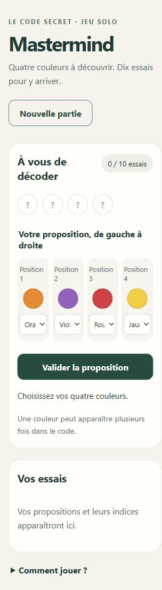
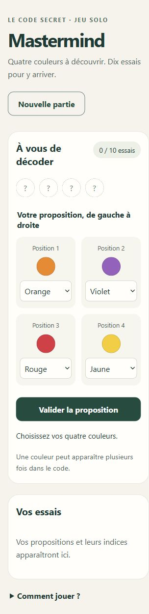

- Dépôt : [Paul-heg/Code_secret](https://github.com/Paul-heg/Code_secret).
- Application : [jouer au Mastermind](https://paul-heg.github.io/Code_secret/).
- Version du rendu : [tag `jalon-1`](https://github.com/Paul-heg/Code_secret/tree/jalon-1).

# Règles

- Référence : code-couleurs-1.0.
- Cette variante pédagogique s’inspire du [Mastermind](https://instructions.hasbro.com/fr-fr/instruction/mastermind-board-game-for-families-and-kids-the-classic-code-cracking-game-family-gifts-family-games). Pour le projet, les règles ci-dessous font foi ; elles ne reprennent pas toutes les variantes commerciales.
- La palette est commune : rouge, bleu, vert, jaune, orange, violet. Ce sont aussi les six identifiants exacts de l’API, en minuscules, dans cet ordre. Au début, l’application choisit au hasard quatre de ces couleurs, avec répétitions possibles. Cette combinaison reste fixe et cachée.
- La personne dispose de dix essais. Chaque proposition comporte quatre couleurs ordonnées de gauche à droite, modifiables avant validation.
- Une proposition incomplète ou contenant une couleur non autorisée est refusée avec une explication, sans consommer d’essai ni modifier l’historique.
- Chaque proposition valide consomme un essai. La proposition et ses indices restent consultables jusqu’à la nouvelle partie.
- L’indice donne deux nombres : couleurs bien placées et couleurs présentes mais mal placées. Comptez d’abord les bien placées, puis les mal placées parmi les occurrences restantes. Chaque occurrence du secret et de la proposition compte au maximum une fois. Les indices ne désignent pas les positions concernées.
- Quatre couleurs bien placées donnent la victoire, même au dixième essai. Après dix propositions sans victoire, la partie est perdue.
- Après victoire ou défaite, les propositions ne changent plus la partie. « Nouvelle partie » choisit un code et remet à zéro les essais, l’historique et les indices.

# Choix

## Objectif et périmètre

Permettre à une personne de jouer seule au Mastermind selon les règles ci-dessus. Le jeu s’ouvre directement avec `index.html` dans un navigateur, sans serveur, installation ni connexion Internet. La partie reste en mémoire pendant l’ouverture de la page.

Les règles et les critères d’acceptation décrivent le comportement à reproduire. L’organisation des fonctions ci-dessous décrit l’implémentation actuelle : une réimplémentation peut adopter une autre structure en conservant les comportements attendus et des tests équivalents.

## Choix techniques actuels

Décision prise avec Codex : nous avons retenu un fichier HTML autonome pour faciliter le partage et permettre de jouer hors ligne, sans installation. Codex a proposé cette organisation et je l’ai validée. Le HTML, les styles et la logique restent regroupés dans `index.html` ; Node.js est réservé aux vérifications de développement. Ce choix convient au périmètre limité de ce jeu, tout en demandant de distinguer clairement la logique et l’interface dans le fichier.

- Le jeu tient dans un fichier `index.html` autonome, sans installation ni dépendance externe, pour faciliter son ouverture, son partage et son utilisation hors ligne.
- Quatre sélecteurs permettent de choisir et de modifier les couleurs avant validation, pour rendre explicite l’ordre des positions et limiter les erreurs de saisie.
- Les couleurs sont accompagnées de leur nom pour permettre de les identifier sans dépendre uniquement de leur apparence.
- L’historique conserve les propositions et leurs indices jusqu’à la nouvelle partie, pour permettre de comparer les essais et de construire un raisonnement.

Le fichier `index.html` regroupe la structure HTML, les styles CSS, le calcul des indices, la gestion de partie et les interactions. `tests/mastermind.test.cjs` vérifie la logique sans dépendance externe ; Node.js sert uniquement aux tests et n’est pas nécessaire pour jouer.

## Parcours d’une partie

| Étape | Comportement attendu |
| --- | --- |
| Ouverture | Tirer quatre couleurs avec répétitions possibles, cacher le code et afficher quatre positions à compléter, un compteur à 0 sur 10 et un historique vide. |
| Saisie | Permettre de choisir et de modifier séparément chacune des quatre positions avant validation. |
| Proposition refusée | Expliquer le problème ; conserver le code, les essais déjà joués et l’historique. |
| Proposition acceptée | Ajouter exactement un essai avec les quatre couleurs ordonnées et les deux nombres d’indices ; mettre à jour le compteur. |
| Victoire | Annoncer la victoire dès que les quatre couleurs sont bien placées, y compris au dixième essai ; conserver l’historique et bloquer les propositions suivantes. |
| Défaite | Annoncer la défaite après dix propositions sans victoire ; conserver l’historique et bloquer les propositions suivantes. |
| Nouvelle partie | Tirer un code, vider les sélections, les essais, l’historique et les indices, puis permettre de jouer. Le nouveau tirage peut produire le même code que le précédent. |

Dans la version actuelle, les sélections restent affichées après une proposition valide et le code n’est pas révélé en fin de partie. Ces choix d’interface ne constituent pas des règles supplémentaires.

## Contrat des données et des fonctions

Le terme « API » des règles désigne ici l’interface JavaScript interne, sans service réseau. Les six identifiants sont exactement `rouge`, `bleu`, `vert`, `jaune`, `orange`, `violet`, dans cet ordre. Une proposition est un tableau de quatre identifiants, de gauche à droite. Les répétitions sont autorisées ; les noms affichés peuvent commencer par une majuscule, mais les valeurs utilisent les identifiants minuscules.

| Élément actuel | Entrée et résultat |
| --- | --- |
| `calculerIndices(secret, proposition)` | Reçoit deux tableaux valides de quatre couleurs ; retourne `{ bienPlacees, malPlacees }`. Les deux nombres sont des entiers entre 0 et 4 et leur somme ne dépasse pas 4. La validation des entrées relève de `proposer()`. |
| `creerPartie()` | Tire un code avec `Math.random()` et retourne les méthodes `proposer` et `consulter`. Le code reste fixe dans cette partie et n’est pas retourné par ces méthodes. |
| `creerPartie(secret)` | Accepte un tableau valide de quatre couleurs pour rendre les tests déterministes. Ce paramètre est un point d’entrée de test ; l’interface du jeu ne le fournit pas. Son invalidité n’est pas prise en charge. |
| `proposer(proposition)` acceptée | Consomme un essai et retourne `{ etat, historique }`, après calcul des indices et mise à jour de l’état. |
| `proposer(proposition)` refusée | Retourne `{ erreur }`, où `erreur` est un texte explicatif non vide ; ne modifie aucune donnée de partie. Vérifie d’abord si la partie est terminée, puis si la proposition est complète, puis si les couleurs sont autorisées. |
| `consulter()` | Retourne `{ etat, historique }`, avec des copies des propositions pour empêcher qu’une modification du résultat altère la partie. |
| `etat` | Vaut exactement `en-cours`, `victoire` ou `defaite`. La victoire est évaluée avant la défaite au dixième essai. |
| `historique` | Tableau dans l’ordre chronologique. Chaque entrée contient `{ proposition, bienPlacees, malPlacees }`. Sa longueur est le nombre d’essais consommés. |

Pour refaire le comptage, retirer d’abord les occurrences bien placées, puis compter les correspondances de couleurs parmi les occurrences restantes en les retirant à mesure. Aucun indice n’est associé à une position affichée.

## Critères d’acceptation de l’interface

- Les quatre positions sont identifiables et ordonnées de gauche à droite.
- Chaque couleur est identifiable par son nom, sans dépendre uniquement de son apparence.
- Les indices donnent seulement les deux nombres globaux et ne marquent pas les positions concernées.
- Toutes les propositions validées et leurs indices restent consultables jusqu’à la nouvelle partie.
- Les refus et les fins de partie sont expliqués par un message visible ; le compteur reflète uniquement les propositions acceptées.
- Les sélecteurs et boutons ont un libellé et doivent pouvoir être utilisés au clavier ; les messages doivent pouvoir être annoncés par un lecteur d’écran. La présence de ces éléments dans le code ne remplace pas les tests d’accessibilité.

# Vérifications

## Relancer les tests de logique

Prérequis pour les tests : Node.js 24 ou une version ultérieure. Depuis le dossier du projet, exécuter :

```sh
node --test tests/mastermind.test.cjs
```

Le script lit directement le JavaScript de `index.html` et vérifie les dix cas du tableau ci-dessous sans charger l’interface. Il affiche la version de Node.js et l’empreinte SHA-256 du fichier essayé. Le résultat attendu est dix tests réussis, aucun échec et un code de sortie égal à zéro. Une erreur produit un échec explicite. Aucune installation de bibliothèque n’est nécessaire. Ces tests ne couvrent pas les styles ; la correction d’affichage ci-dessous nécessite également un contrôle dans le navigateur.

Si la structure du fichier HTML ou les noms des fonctions changent, adapter le chargement du script de test sans supprimer les cas métier correspondants.

## Résultats des tests de logique

Dernière exécution après la correction d’affichage, le 20 novembre 2026, avec Node.js `v24.22.1` : 10 tests réussis, 0 échec, code de sortie 0. Empreinte SHA-256 de `index.html` essayé : `b111d7e69e9b0a257faf13def541ef01f17ee6a6952afb0f1682e9f35264b01e`. La logique n’a pas changé ; la modification porte sur la disposition des sélecteurs aux petites largeurs.

Exécution antérieure au correctif, avec Node.js `v24.22.1` : également 10 tests réussis, 0 échec. Empreinte SHA-256 : `4b09466e1a0cf5a7bf5603d3f12df80e111948edc2ca02a4474381560db4c370`. Ces résultats montrent que les tests de logique seuls ne détectaient pas le défaut d’affichage.

Le tableau ci-dessous conserve les résultats initiaux obtenus sur la logique JavaScript de la version GitHub `2befa09`, selon les règles `code-couleurs-1.0`. Les mêmes dix cas ont été rejoués après la correction et restent conformes. Ces tests automatisés ne chargent pas l’interface dans un navigateur.

Sauf indication contraire, le code secret utilisé est `rouge, bleu, rouge, vert`. Les couleurs sont données de gauche à droite.

| Cas testé | Résultat attendu | Résultat obtenu | Version essayée |
| --- | --- | --- | --- |
| 1. Couleurs répétées : proposer `rouge, rouge, bleu, rouge`. | 1 bien placée et 2 mal placées ; la dernière occurrence de rouge proposée ne compte pas. | 1 bien placée et 2 mal placées. Conforme. | `2befa09` |
| 2. Aucune couleur présente : proposer `jaune, jaune, orange, violet`. | 0 bien placée et 0 mal placée. | 0 bien placée et 0 mal placée. Conforme. | `2befa09` |
| 3. Toutes les couleurs mal placées : proposer `bleu, rouge, vert, rouge`. | 0 bien placée et 4 mal placées. | 0 bien placée et 4 mal placées. Conforme. | `2befa09` |
| 4. Proposition incomplète : après un essai valide, proposer `rouge, bleu, vide, vert`. | Refus avec une explication ; le nombre d’essais reste à 1 et l’historique reste identique. | Refus avec une explication ; 1 essai et historique inchangé. Conforme. | `2befa09` |
| 5. Couleur interdite : après un essai valide, proposer `rouge, bleu, rose, vert`. | Refus avec une explication ; le nombre d’essais reste à 1 et l’historique reste identique. | Refus avec une explication ; 1 essai et historique inchangé. Conforme. | `2befa09` |
| 6. Victoire au dixième essai : proposer neuf fois `jaune, jaune, jaune, jaune`, puis le code exact. | Victoire au dixième essai, avec 4 bien placées et 0 mal placée. | État de victoire, 10 essais, 4 bien placées et 0 mal placée. Conforme. | `2befa09` |
| 7. Défaite au dixième essai : proposer dix fois `jaune, jaune, jaune, jaune`. | Défaite après exactement 10 essais. | État de défaite et 10 essais enregistrés. Conforme. | `2befa09` |
| 8. Partie terminée : après une victoire, puis dans une autre partie après une défaite, proposer le code exact. | Refus dans les deux cas, sans modifier l’état de la partie, les essais ni l’historique. | Refus et état complet inchangé dans les deux cas. Conforme. | `2befa09` |
| 9. Nouvelle partie dans la logique : après une victoire, créer une nouvelle partie avec `creerPartie()`. | État en cours et historique vide, soit 0 essai. | État en cours et historique vide. Conforme. | `2befa09` |
| 10. Conservation des propositions : valider `jaune, jaune, jaune, jaune`, puis modifier le tableau de saisie et une copie de l’historique retournée par `consulter()`. | La proposition enregistrée reste `jaune, jaune, jaune, jaune`, avec 0 bien placée et 0 mal placée. | Proposition et indices enregistrés inchangés. Conforme. | `2befa09` |

## Correction d’un défaut réel : noms de couleurs tronqués

**Défaut reproduit :** sur la version [ebc9c11](https://github.com/Paul-heg/Code_secret/commit/ebc9c114882b66bc71b04905c94e979f2b116a7e), ouvrir l’application avec une fenêtre de 320 × 740 pixels et choisir `orange, violet, rouge, jaune`. Les quatre sélecteurs restent sur une seule ligne et les noms des couleurs sont tronqués. Cela gêne leur identification par le texte.

**Résultat attendu :** pouvoir lire entièrement le nom choisi dans chacune des quatre positions.

**Correction :** ajouter une règle CSS pour les fenêtres d’au plus 480 pixels : les sélecteurs passent sur deux colonnes, avec des noms plus grands. Les libellés « Position 1 » à « Position 4 » restent visibles et le code conserve son ordre. Aucun calcul d’indices ni aucune règle de partie n’est modifié.

| Preuve | Résultat |
| --- | --- |
| [Avant correction](preuves/mobile-avant.jpg), version `ebc9c11`, fenêtre de 320 × 740 pixels. | Les noms sélectionnés sont tronqués. Défaut constaté dans le navigateur intégré de ChatGPT. |
| [Après correction](preuves/mobile-apres.jpg), version [65bc234](https://github.com/Paul-heg/Code_secret/commit/65bc234bd076e7e85296bc4b3dd78cc4cbab2b31), même fenêtre et mêmes couleurs. | Les quatre noms sont lisibles entièrement sur deux colonnes. |





## Contrôles d’interface réalisés

Contrôles exécutés le 20 novembre 2026 sur GitHub Pages, dans le navigateur intégré de ChatGPT sur ordinateur. La version exacte du navigateur n’a pas été relevée ; le contrôle à 320 pixels simule une fenêtre étroite et ne remplace pas un test sur téléphone physique.

| Version essayée | Manipulation | Résultat attendu | Résultat obtenu |
| --- | --- | --- | --- |
| `ebc9c11` | Ouvrir l’application en ligne. | Afficher les quatre positions, 0 essai et un historique vide. | Conforme ; le jeu est accessible sur GitHub Pages. |
| `ebc9c11` | Valider une proposition vide. | Afficher une explication, conserver 0 essai et l’historique vide. | Conforme. |
| `ebc9c11` | Choisir `rouge, bleu, vert, jaune` et valider. | Enregistrer la proposition et ses indices et passer à 1 essai. | Conforme ; 0 bien placée et 2 mal placées pour le tirage de cette partie. Le secret étant caché, ce contrôle ne prouve pas le calcul des indices, vérifié séparément par les tests de logique. |
| `ebc9c11` | Cliquer sur « Nouvelle partie » après cet essai. | Vider les sélections, l’historique et les indices, remettre le compteur à 0 et permettre de jouer. | Conforme. |
| `65bc234` | À 320 × 740 pixels, choisir `orange, violet, rouge, jaune` après correction. | Lire les quatre noms et conserver les quatre positions sans débordement horizontal. | Conforme : deux colonnes, quatre noms entiers et aucune largeur dépassant celle de la fenêtre. |

## Contrôles manuels à poursuivre

Ces contrôles constituent une procédure ; ils ne sont pas déclarés réussis tant qu’une exécution n’a pas été consignée.

| Contrôle | Manipulation et résultat attendu |
| --- | --- |
| Ouverture et présentation | Ouvrir `index.html` sans connexion Internet, sur ordinateur puis sur mobile. Vérifier que les textes et commandes sont lisibles, que les quatre positions sont visibles et que l’historique reste consultable après plusieurs essais. |
| Saisie et refus | Soumettre une proposition incomplète : un message explique le refus, le compteur et l’historique ne changent pas. Choisir ensuite quatre couleurs et en modifier une avant validation : seule la proposition finale est enregistrée. |
| Fin de partie | Sur une copie de test, fournir un secret connu à `creerPartie(secret)` dans l’initialisation de l’interface. Vérifier une victoire, une victoire au dixième essai et une défaite ; vérifier les messages, les commandes désactivées et l’historique conservé. Ne pas livrer cette modification du tirage. |
| Nouvelle partie | Après plusieurs essais, puis après chacune des deux fins de partie, cliquer sur « Nouvelle partie » : sélections vides, compteur à 0, historique et indices effacés, commandes utilisables. |
| Clavier | Parcourir les commandes avec Tab et Maj+Tab, modifier chaque sélecteur et activer les boutons au clavier. Vérifier que le focus est visible et qu’aucune commande n’est inaccessible. |
| Lecteur d’écran | Vérifier l’annonce des positions, des noms de couleurs, des boutons, des indices de chaque essai et des messages de refus ou de fin de partie. |

Pour chaque contrôle exécuté, consigner la date, le commit ou l’empreinte du fichier essayé, le navigateur et sa version, l’appareil, les éventuels outils d’assistance, le résultat attendu et le résultat obtenu. Un résultat non testé ou différent de l’attendu reste visible dans « Limites ».

# Limites

## Comportements encore incertains ou non testés

- Le rendu et les interactions restent à vérifier sur téléphone physique et dans les autres navigateurs. Une vérification à 320 pixels dans le navigateur intégré ne garantit pas toute la compatibilité mobile.
- Le fonctionnement hors ligne et la lisibilité d’un historique de dix essais restent à vérifier dans l’interface.
- L’utilisation au clavier et avec un lecteur d’écran n’a pas été testée.
- La remise à zéro par « Nouvelle partie » est vérifiée après un essai ; elle reste à vérifier dans l’interface après une victoire et après une défaite.
- Les messages de victoire et de défaite ainsi que le blocage des commandes en fin de partie restent à vérifier dans l’interface. Le refus d’une proposition vide a été contrôlé.

## Questions ouvertes à confirmer avant modification

- Faut-il révéler le code à la fin d’une partie ? La version actuelle le garde caché ; les règles ne précisent pas une révélation finale.
- Quels navigateurs, versions et appareils doivent être officiellement pris en charge ? La compatibilité reste à établir par les contrôles manuels.
